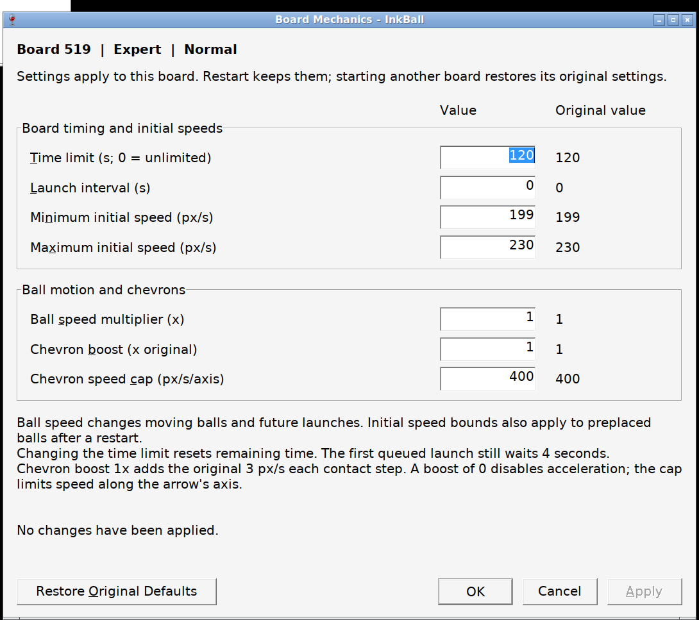
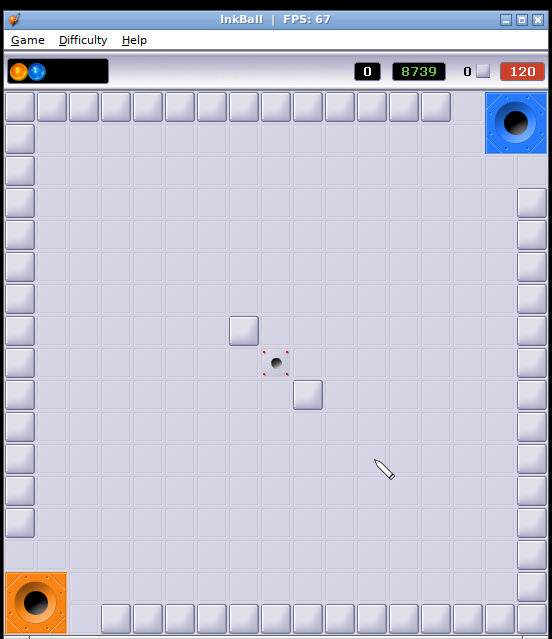

# Version 1.2 build and validation results

Validated on **1 November 2026**. The input for this update was the attached
`InkBall-VS2026-updated(1).zip` version 1.1 project. Its contents were compared
with the working project before editing. Historical extraction evidence is
in `ORIGINAL_ASSETS.json` and `RECONSTRUCTION.md`; the original installer was
not re-extracted for this update.

## Delivered executable

- File: `bin/Prebuilt-x64/inkball.exe`
- Version: **1.2.0**
- Format: native Windows PE32+ / x86-64 desktop executable
- Size: **3,699,069 bytes**
- SHA-256: `7c94311cb5d5b3cc3d677eaa7f5d1f372dae606a3eba6b36f77d9c50a6db8682`
- Build: GCC 13 / MinGW-w64, C++20, optimized, with statically linked compiler support libraries.
- Imports: `COMCTL32.dll`, `GDI32.dll`, `KERNEL32.dll`, `MSIMG32.dll`, `msvcrt.dll`, `SHELL32.dll`, and `USER32.dll`. No separate GCC, libstdc++, winpthread, or .NET DLL is required.

Source, project configuration, resources, and test inputs were hashed before
and after the final build and checked again before packaging. Binary
identities, input hashes, resource comparisons, and measured results are in
`BUILD_VERIFICATION.json`. Integrated GUI checks use the executable above.
Independent form/performance checks have the narrower scopes stated below.

## Completed checks

| Check | Result |
| --- | --- |
| CMake Linux build and CTest | Engine and catalog passed |
| Engine suite, including mechanics overrides | **666 checks passed** |
| Board catalog suite | **38 checks passed** |
| Updated engine with strict warnings, ASan, and UBSan | **666 checks passed**, no sanitizer diagnostics |
| Default physics compared with version 1.1 | Matching sampled state on all **551** boards |
| Windows cross-build | Game, resources, and three test EXEs built |
| Windows engine/catalog EXEs under Wine | **666 + 38 checks passed** |
| Windows renderer EXE under Wine | **79 checks passed** |
| Final game all-board smoke | All **551** boards load, simulate briefly, and render |
| Integrated final GUI/runtime checks | **43 checks passed** |
| Independent mechanics form at 150% DPI | **21 checks passed** |
| Original level, bitmap, and icon | Byte-identical to recovered assets in the input project |
| Original menu resources | All **35** languages retained |
| Manifest | Exactly one valid embedded manifest; common-controls v6 and PerMonitorV2 retained |
| Four Visual Studio projects and solution | XML, file references, GUIDs, v145 targets, and all configurations checked |

Counts are assertions/cases, not manual completed playthroughs of every
board. The GUI report includes the three Windows test invocations and the
all-board smoke; these are not extra independent unit-test totals.

## Browser responsiveness

Code inspection identified four sources of unnecessary work in version 1.1:

1. A paused game still received its 15 ms timer and drew a complete frame behind the browser. Both windows use the same UI thread.
2. Every frame issued drawing calls for all 289 board cells.
3. Filtering/sorting rebuilt 551 list items and all six strings per row.
4. Resizing called `MoveWindow(..., TRUE)` for each child, causing immediate individual repaints and repeated column sizing.

Version 1.2 stops the timer while paused or in a dialog, guards against an
already-queued timer message, and defers drawing to `WM_PAINT`, allowing
multiple state updates to share one presentation. The renderer caches the
tile background and updates changed cells. The browser uses a virtual list
backed by cached strings, batches child placement, and coalesces pending
previews to the latest selected board.

Before/after measurements below ran under Wine 9, Xvfb, and Openbox on Linux.
These isolated render/browser harnesses **exclude the additional benefit of
stopping the paused owner game's timer**.

| Operation | Samples | Version 1.1 median | Version 1.2 median |
| --- | ---: | ---: | ---: |
| Draw and present at 150% size | 600 | 1.0073 ms | 0.7187 ms |
| Select board and finish preview | 80 | 35.7834 ms | 28.6940 ms |
| Sort all boards and finish list paint | 40 | 49.3809 ms | 29.8257 ms |

The selection sample includes board 519. Distribution summaries including
95th percentiles and maxima are in `BUILD_VERIFICATION.json`. The reported
multi-second delay on the user's Windows desktop **was not reproduced here**.
The measurements support specific reductions in work; they do not establish
native-Windows latency or every possible cause on that desktop.

A separate integrated check counted messages removed from the actual game
window's message queue while the browser was open. Over matched 1.5-second
intervals, version 1.1 processed **100 timer and 100 paint messages**; version
1.2 processed **zero timer and zero paint messages**. This used an external
QA-only message hook; no instrumentation is included in the delivered game.
It measures redundant work, not CPU percentage.

## Mechanics and unchanged defaults

The engine suite adds settings validation and atomic rejection, live
velocity rescaling, future launch speeds, timer and launch-interval changes,
chevron boost/cap behavior, restart retention, resetting overrides on another
board, and preservation of positions, score, pause, and original board data.

Version 1.1 and version 1.2 engines were built separately and run with seed
12345 at 1/120-second ticks on all 551 boards. Sampled state at 0, 2, 4, and
6 seconds matched exactly with default settings. Both produced state hash
`7bb711d1add8602e`. This compares with the previous reconstruction; it is not
proof of equivalence with every trajectory of Microsoft's original EXE.

The independent mechanics dialog harness used the actual form and engine at
144 DPI (150%). Its 21 checks cover seven fields and original values,
blank/invalid input rejection, unchanged game state after invalid Apply and
Cancel, keyboard mnemonics, Ctrl+A, focus scrolling, Tab navigation to footer
actions, Apply without closing, reopening applied values, and restoring
defaults only after Apply/OK. Apply followed by Cancel retains the successful
application. The form was visually inspected at its initial size and after
resizing and scrolling.



## Rendering and score preservation

The 79 renderer checks retain the ink/transparency/resize checks and add four
cached-background cases: removed walls, changed gate frames, a different
board, and clearing old ball/ink pixels before composition. Coverage includes
10-pixel native and 20-pixel 200%-scaled ink, rounded caps/joins and dots,
all five ball colors at four radii, normal and near-hole sprites, no purple
border, 125% scaling, multiple client geometries, repeated resizing,
clipped/full repaints, and input mapping.

Before/after render comparisons are pixel-identical for the benchmark state,
for both the whole frame and its HUD. `Renderer::number`, `Renderer::drawHud`,
and `Renderer::destination` are byte-for-byte unchanged from version 1.1.
The sprite bitmap and `COLORONCOLOR` presentation scaling are unchanged.
**No score pixelation fix was applied.** See `SCORE_RENDERING.md` for its cause
and possible future approaches.

The pen is a code-defined white shape with a dark outline, reconstructed
from the original-gameplay video. Its active point is the nib, it scales
with DPI, and it appears only over the playable board. HUD, margins, and
window controls retain normal pointers. It is not an extracted original
cursor resource and does not depend on the legacy Tablet PC ink component.

## Final application checks

The integrated report covers browser filtering, sorting, selection, previews,
tile inspection, launching the selected board, and restoring a paused game;
the mechanics entry point and restart; optional measured FPS and paused
title indication; and the pen on the board with the arrow on the HUD. It
also runs all three Windows test EXEs and the all-board smoke.

All **43 integrated checks passed** on the final executable. Six completed
selection/preview updates took **41.9-53.0 ms**; the two board 519 samples
took 49.7 and 47.9 ms. An actual drag was followed by a successful inspection
in 0.216 seconds (including the harness settling delay). The cursor server
reported a 32 x 32 pen with a (1, 1) hotspot at native DPI. Its pixels were
composited at that hotspot into the capture because ordinary screenshots
omit the server cursor; the resulting pen was visually inspected. These
measurements are specific to the Wine test environment.

FPS counts completed game-window paint presentations during the measurement
interval. It is not a monitor refresh-rate query or a physics-substep count.
A paused game deliberately does not redraw continuously.



`beginner.png` and `expert.png` are fresh 544 x 586 outputs of the final native
renderer: board 0 after five simulated seconds and board 489 after two, both
with seed 1. `ink-and-transparency.png` and `tile-inspector.png` retain the
version 1.1 visual reference; current regression tests still cover those
behaviors.

## Validation limits

- **Visual Studio 2026/MSVC was not available in this Linux environment.** The `.sln` and four `.vcxproj` files target v145 and were structurally checked. The explicit `1 RT_MANIFEST "../assets/app.manifest"` declaration remains absent; MSVC's manifest tool owns embedding. A native MSVC build is not claimed as performed.
- Windows executables ran under **Wine 9**, not native Windows 10/11. The included/tested binary is x64. Debug/Release and Win32/x64 source configurations are supplied; no x86 binary was built.
- Physical pen hardware and a real multi-monitor DPI transition were unavailable. Mouse interaction, scaled rendering, 150% form layout, and inverse pointer mapping were checked.
- Original timing, legacy Tablet PC stroke fitting/pressure, and exact floating-point trajectories remain reconstruction limits. Video matching does not prove frame-for-frame equivalence on every board.

## Reproduce on Windows

The script builds the solution and runs all three test programs:

```powershell
.\Build.ps1 -Configuration Release -Platform x64
```

Or open `InkBall.sln` in Visual Studio 2026, select **Release | x64**, build,
and run from the package root:

```bat
bin\x64\Release\InkBall.EngineTests.exe assets\levels.ikl
bin\x64\Release\InkBall.CatalogTests.exe assets\levels.ikl
bin\x64\Release\InkBall.RendererTests.exe
bin\x64\Release\inkball.exe --smoke-test
bin\x64\Release\inkball.exe --screenshot board.bmp --level 0 --seed 1 --advance 5
```

The included test programs use the same commands with `bin\Prebuilt-x64\` as
the directory. Expected output:

```text
PASS: 666 checks, including all 551 original boards and gameplay regressions.
PASS: 38 catalog checks, all 551 original boards.
PASS: 79 renderer checks for ink, ball transparency, repaint stability, resize, and input mapping.
```

Portable engine/catalog tests on Linux or macOS:

```sh
cmake -S . -B build -DCMAKE_BUILD_TYPE=Release
cmake --build build
ctest --test-dir build --output-on-failure
```

`tools/mingw-x64.cmake` supports a cross-build with MinGW-w64 installed; it
is not required for Visual Studio.
